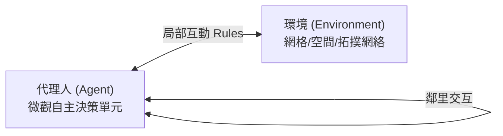

# 02. ABM 核心三要素 (Core Components of ABM)

代理人基模型系統由三大不可分割的核心支柱構成 [Source 1]：

## 1. 代理人 (Agent)
- **定義**：模擬世界中最基礎的自主實體（如人類個體、企業、車輛或生物個體）[Source 1]。
- **核心特徵**：
  - **內部狀態 (Internal States)**：如空間座標、資產財富、健康指標、主觀偏好等 [Source 1]。
  - **決策準則 (Decision Rules)**：根據感知到的環境資訊採取行動的啟發式邏輯（如「若同類鄰居不足則搬家」）[Source 1]。
  - **有限視野 (Bounded Horizon)**：代理人只能感知局部環境，不具備全域資訊 [Source 1]。

## 2. 環境 (Environment)
- **定義**：代理人所處的空間與資源載體 [Source 1]。
- **常見型態**：
  - **離散網格 (Grid / Lattice)**：如二維方格棋盤世界（Cellular spaces）[Source 1]。
  - **連續空間 (Continuous 2D/3D Space)**：具有精確物理距離與連續座標 [Source 1]。
  - **社群網路拓撲 (Network Topologies)**：無尺度網路、小世界網路或隨機圖 [Source 1]。
- **動態性**：環境資源可隨時間再生、衰減或產生氣候/障礙物變遷 [Source 1]。

## 3. 互動機制 (Interaction Rules)
- **定義**：代理人與鄰近代理人、以及代理人與環境之間交換物資、資訊的通訊與博弈協議 [Source 1]。
- **在地性原則 (Locality Principle)**：在傳統 ABM 中，互動幾乎都是局部的（如 Moore 鄰域 8 格或 von Neumann 鄰域 4 格），宏觀現象是由局部的微小漣漪交織疊加而成 [Source 1]。

## 經典三要素實例映射：謝林隔離模型
以謝林模型為例，三要素具體體現為 [Source 2]：
- **Agent**：具有族群標籤（紅/藍）與滿意度門檻 $T$（如 30%）的虛擬居民 [Source 2]。
- **Environment**：離散的二維方格網格（棋盤），包含佔用格與隨機空位 [Source 2]。
- **Interaction**：觀察周圍相鄰 8 格（Moore 鄰域）的同類比例；若滿意則安居，不滿意則隨機搬遷至空位 [Source 2]。

## 互動中的非線性反饋機制
代理人之間的互動並非單向流動，而是充滿了正負回饋循環 [Source 3]：
- **正回饋 (Positive Feedback)**：例如恐慌性拋售或謠言傳遞，個體決策會刺激其他個體強化同類行為，促使系統急速遠離平衡態 [Source 3]。
- **負回饋 (Negative Feedback)**：例如資源短缺引發的抑制機制，維持生態或市場的相對動態平衡 [Source 3]。

## 代理人的異質性與有限心智
- **屬性與網絡異質性**：代理人具備多元屬性（如年齡、財富、門檻偏好），並在社群網絡中佔據不同拓撲位置（如意見領袖 Hub vs 邊緣個體），使得系統對外部衝擊的反應高度多樣化 [Source 4]。
- **有限理性 (Bounded Rationality)**：依據 Herbert Simon 的理論，代理人無法運算全域最優解，而是依據簡捷啟發式規則（Heuristics）追求局部「滿意解」[Source 4]。

## 空間拓撲與網絡結構對互動的制約
與方程式模型假設「均勻混合（Well-mixed）」不同，ABM 強調環境空間與網絡結構的非均質性。資訊與資源的流動受到真實空間幾何與社交拓撲的剛性制約，避免了巨觀模型過度簡化導致的失真 [Source 5]。
