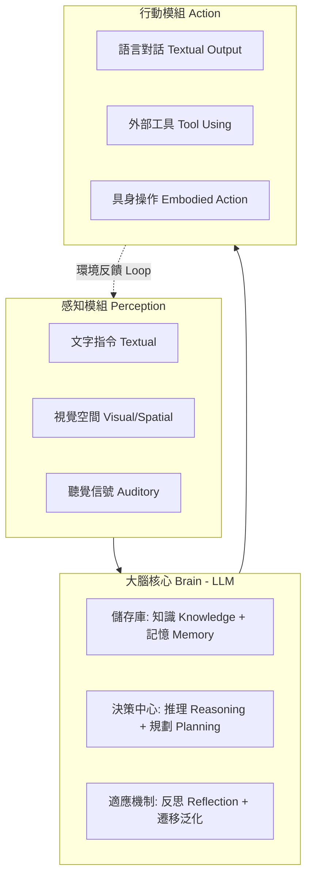

# 代理人經典三元架構 (Brain-Perception-Action)

> [!NOTE] 定義與直覺
> 經典三元架構是現代大語言模型代理人（LLM-based Agents）的標準本體論結構。它借鑑了人類與認知科學的生理機能，將自主代理人解構為三大相互協作的組件：作為中央控制器的「大腦 (Brain)」、作為感官輸入的「感知 (Perception)」以及作為肢體與工具執行的「行動 (Action)」。

---

## 1. 三大組件詳細拆解 (Components Breakdown)

### 1.1 大腦 (Brain)
- 代理人的心智核心（由 LLM 擔任）。
- **知識與記憶**：不僅儲存領域知識，更透過長短期記憶（如 [[Memory-Stream]]）記錄過往生命歷程。
- **推理與規劃**：透過 CoT、ToT（思維樹）將目標拆解為可執行的子任務，並利用 [[Reflection-Mechanism]] 動態修正策略。

### 1.2 感知 (Perception)
- 負責將真實或虛擬世界的多模態資訊轉換為 LLM 能夠理解的語義表示。
- 不再局限於文字，還涵蓋視覺對齊（如 ViT 提取的物體與座標）、空間幾何拓撲圖等。

### 1.3 行動 (Action)
- 代理人施加於環境的具體輸出：
  - **自然語言互動**：與其他代理人或人類交流。
  - **工具調用 (Tool Using)**：調用外部計算器、API、資料庫查詢語言。
  - **具身實體行動 (Embodied Action)**：在模擬世界或物理空間中移動位置、操作物體。

---

## 2. 關聯研究與頁面 (Related Links)
- 奠基文獻：[[2023_Xi_LLM-Based-Agents-Survey]]
- 具體實作：[[2023_Park_Generative-Agents]], [[Generative-Agents]]
- 群體延伸：[[Agent-Society-Properties]], [[Multi-Agent-Coordination]]
