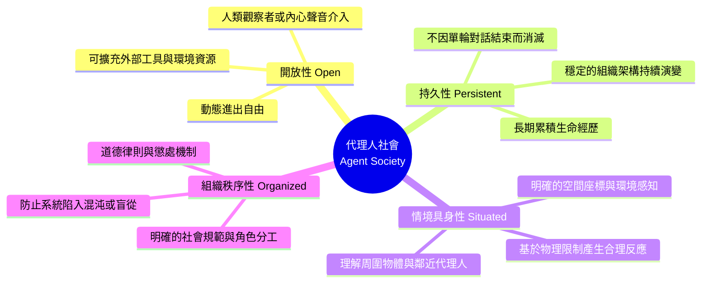

# 代理人社會四大特徵 (Properties of Agent Society)

> [!NOTE] 定義與直覺
> 當大量的自主代理人（LLM-based Agents）共存並互動時，個體行為將交織演變為群體現象。根據 [[2023_Xi_LLM-Based-Agents-Survey]] 的界定，一個能夠穩定模擬人類社會動態的「代理人社會（Agent Society）」必須具備四大基石特徵：開放性 (Open)、持久性 (Persistent)、情境具身性 (Situated) 與組織秩序性 (Organized)。

---

## 1. 四大基本特徵解析 (The Four Cardinal Properties)

1. **開放性 (Open)**：
   - 社會並非閉門造車的封閉系統，代理人可以依任務動態加入或離開。
   - 人類可以「化身為居民」或以「內心聲音（Inner Voice）」直接干預演化方向。
2. **持久性 (Persistent)**：
   - 解決傳統聊天機器人「對話結束即遺忘」的硬傷。代理人的經歷與人際關係透過 [[Memory-Stream]] 持續沉澱，形成連貫的歷史軌跡。
3. **情境具身性 (Situated)**：
   - 代理人不是懸浮於虛空中的文字產生器，而是深植於特定時空脈絡中（如小鎮的咖啡廳、家庭住宅），其決策受限於視野與空間距離。
4. **組織秩序性 (Organized)**：
   - 社會群體需要結構。包含組織階層、標準作業程序（SOP）或潛在激勵機制，引導個體行動朝向集體目標推進。

---

## 2. 關聯研究與頁面 (Related Links)
- 綜述來源：[[2023_Xi_LLM-Based-Agents-Survey]]
- 經典實例：[[2023_Park_Generative-Agents]]（Smallville 虛擬小鎮）
- 群體互動：[[Multi-Agent-Coordination]], [[Social-Simulation-ABM]]
- 全景綜述：[[LLM-Agent-Based-Modeling]]
