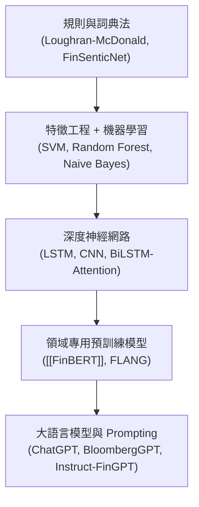

# 金融情緒分析 (Financial Sentiment Analysis, FSA)

> [!NOTE] 定義與直覺
> 金融情緒分析（FSA）是指利用自然語言處理與文字探勘技術，從金融相關文字（如財經新聞、社群論壇、財報 10-K、法說會逐字稿）中自動辨識並量化投資人、分析師或管理階層的情緒極性（正面、負面、中立）與主觀態度，藉此輔助市場走勢預測、風險控管與量化交易決策。

---

## 1. 核心技術挑戰與原理 (Core Mechanism & Challenges)
一般領域的情緒分析（如電商商品評論、電影影評）與金融領域有顯著差異：
1. **金融詞彙的語境特異性 (Context-Dependent Terminology)**：
   - 在一般領域，「*liability*」可能指「累贅」，但在金融語境下是客觀的會計科目「負債」。
   - 「*depreciation*」（折舊/貶值）、「*risk*」等詞在一般語料常帶有強烈負面情緒，但在財報中經常純粹是事實陳述。
2. **數值與文字複合 (Numerical-Textual Coupling)**：
   - 包含數值的複合句（例如：「營收成長率放緩至 3%」相較於「虧損收窄至 3%」）需要同時解析數值符號與趨勢方向，單純的單詞情感無法有效判讀。
3. **情緒層級的多樣性**：
   - **文件級 (Document-level)**：整篇年報或新聞的宏觀基調。
   - **段落/句子級 (Sentence-level)**：針對特定事件陳述的情緒。
   - **層面級 (Aspect-level, ABSA)**：區分針對「營收 (Revenue)」、「毛利率 (Margin)」、「未來展望 (Guidance)」等不同特定財務維度的獨立情緒。

---

## 2. 技術演進脈絡 (Evolution & Representative Work)

- **詞表時代**：
  - 傳統通用的 Harvard-IV 詞典在金融情境中誤判率高達 73%；Loughran & McDonald (2011) 建立了第一份廣泛採用的金融情緒詞表。
  - 後續發展出結合概念語義的詞典（如 [[2025_Du_NLP-in-Finance-A-Survey]] 中提及的 FinSenticNet）。
- **預訓練模型時代**：
  - [[FinBERT]] (Araci 2019; Liu et al. 2020) 利用大規模金融新聞與財報語料持續預訓練 BERT，在多個標註資料集上大幅刷新 SOTA。
- **大語言模型時代**：
  - 零樣本與少樣本提示工程（Zero/Few-shot Prompting）展現出優異的情緒理解力；
  - Instruct-FinGPT 與檢索增強生成（RAG）透過領域指令微調，在多個泛化評估上進一步超越單純微調的小型模型。

---

## 3. 常見評估基準 (Benchmarks)
- [[Financial-Sentiment-Benchmarks|Financial PhraseBank]]：金融領域最廣泛使用的句子級情緒分析基準。
- [[Financial-Sentiment-Benchmarks|SemEval 2017 Task 5]]：針對金融新聞與微網誌（Microblogs）的情緒分數預測。
- [[Financial-Sentiment-Benchmarks|FiQA Task 1]]：針對金融論壇與標題的情緒預測。

---

## 4. 關聯研究與頁面 (Related Links)
- 來源文獻：[[2025_Du_NLP-in-Finance-A-Survey]]
- 核心模型：[[FinBERT]], [[Financial-LLM]]
- 下游應用：金融預測、量化投資組合管理、信用評等
- 橫向全景：[[Financial-NLP-Landscape]]
