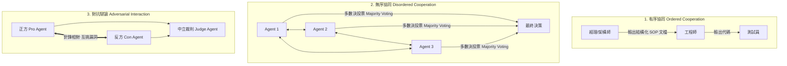

# 多代理人協同與動態機制 (Multi-Agent Coordination)

> [!NOTE] 定義與直覺
> 多代理人協同（Multi-Agent Coordination）探討多個具備異質專長、不同人設目標的 LLM 代理人，如何透過自然語言溝通、協商、分工或競爭對抗，超越單一模型的智力上限，實現「整體大於部分之和」的群體智慧（Collective Intelligence）。

---

## 1. 三大核心協同機制分類 (Coordination Paradigms)

依據 [[2023_Xi_LLM-Based-Agents-Survey]]，多代理人群體互動可分為三種基本拓撲：

### 1.1 有序協同 (Ordered Cooperation)
- **核心邏輯**：將成熟的人類分工與標準作業程序（SOP）注入 Prompt 中（如 MetaGPT、ChatDev）。
- **優勢**：下游代理人僅需針對上游交付的產出進行專門化處理，大幅降低訊息傳遞中的噪音與衝突。

### 1.2 無序協同 (Disordered Cooperation)
- **核心邏輯**：所有代理人在共享白板或對話群中自由發表看法，透過腦力激盪、自由反饋或多數決投票（Majority Voting）凝聚共識。
- **代表場景**：陪審團裁決模擬、政策制定多元觀點諮詢。

### 1.3 對抗辯論 (Adversarial Interaction)
- **核心邏輯**：引入博弈論思維（Game Theory），讓代理人扮演相反立場展開激烈辯論（Tit-for-Tat Debate）。
- **關鍵價值**：**對抗是消除幻覺與偏見的最強抗體**！單一 LLM 容易過度自信，但在針鋒相對的辯論中，對手能輕易抓出邏輯矛盾，倒逼雙方進行深層自我反省。

---

## 2. 協同過程中的核心出錯陷阱 (Failure Modes)
> [!WARNING] 幻覺滾雪球 (Amplification of Hallucination)
> 若多代理人系統缺乏客觀檢驗機制（Gatekeeper / Fact-checker），一個代理人無心捏造的虛假事實（如虛構的歷史事件或錯誤代碼），會被其他代理人誤當作真理接續推演，造成整個社會網絡集體陷入群盲現象。

---

## 3. 關聯研究與頁面 (Related Links)
- 綜述文獻：[[2023_Xi_LLM-Based-Agents-Survey]]
- 社會架構：[[Agent-Society-Properties]], [[Social-Simulation-ABM]]
- 全景綜述：[[LLM-Agent-Based-Modeling]]
