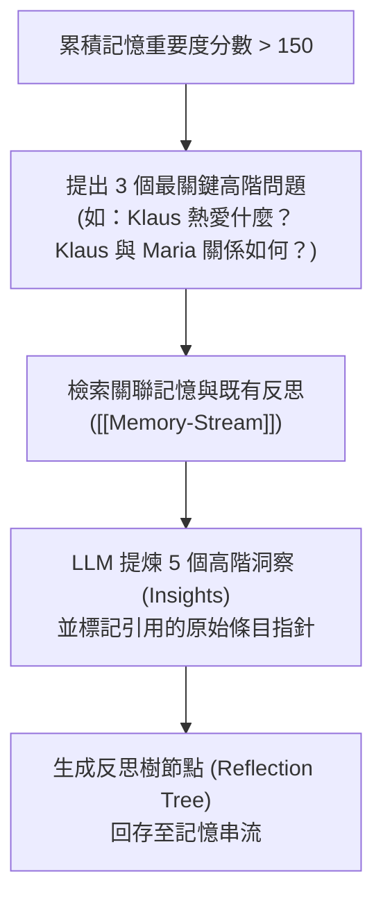

# 反思機制 (Reflection Mechanism)

> [!NOTE] 定義與直覺
> 反思機制（Reflection Mechanism）是代理人將低階「觀察事實（Observations）」昇華為高階「抽象信念（Abstract Insights）」的認知升級處理程序。沒有反思，代理人只是一台記錄客觀事件的攝影機；有了反思，代理人才擁有自我認同、價值偏好與深層推論能力。

---

## 1. 為什麼需要反思？（動機解析）
在 [[2023_Park_Generative-Agents]] 中，若無反思機制，當被問及「*你最想花時間和誰在一起？*」時，代理人 Klaus 只會機械化地選擇「打招呼次數最多」的鄰居 Wolfgang（即使他們只是點頭之交）。
但在引入反思機制後，代理人能回顧與 Maria 的多場深入學術對話，抽象歸納出「*我和 Maria 都對研究充滿熱情*」的高階信念，進而主動選擇邀請 Maria，展現出高度人性化的社交動機。

---

## 2. 反思機制的運作流程 (Operational Pipeline)

1. **觸發閾值**：代理人持續累積經歷，當最新感知事件的重要度分數總和超過門檻（文中使用 150 分，平均每天觸發 2~3 次）時自動觸發。
2. **提問生成**：將最近 100 筆記憶條目輸入 LLM，詢問：「*根據上述資訊，我們可以回答關於主體最重要的 3 個高階問題是什麼？*」
3. **證據檢索與洞察歸納**：以這些問題作為 Query 檢索相關記憶，並命令 LLM 提煉出洞察，格式為：
   `Insight (because of [Memory-ID-1, Memory-ID-2])`
4. **反思樹的建立 (Reflection Tree)**：
   - 葉節點（Leaf Nodes）：真實世界的底層觀察（如「正在閱讀士紳化相關論文」）。
   - 非葉節點（Non-leaf Nodes）：多次反思遞迴生成的抽象思想（如「Klaus 對社會弱勢群體正義具有強烈使命感」）。

---

## 3. 消融實驗成果與啟示
在評估中，移除反思機制的代理人，在性格一致性與深度人際回答的 TrueSkill 評分上顯著下滑（從 29.89 降至 26.88）。反思是代理人跨越「死記硬背」邁向「理解推論」的決定性機制。

---

## 4. 關聯頁面 (Related Links)
- 代表論文：[[2023_Park_Generative-Agents]]
- 搭配機制：[[Memory-Stream]], [[Generative-Agents]], [[Social-Simulation-ABM]]
