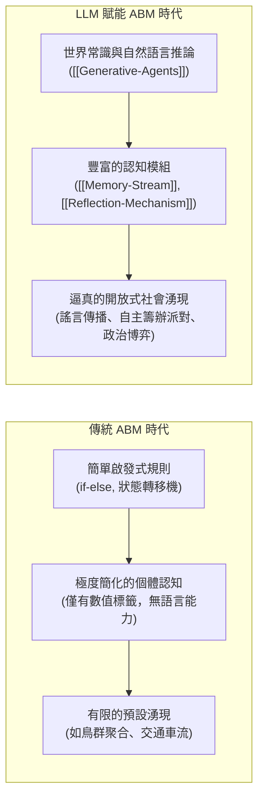

# 代理人基社會模擬 (Agent-Based Modeling & Social Simulation, ABM)

> [!NOTE] 定義與直覺
> 代理人基模型（Agent-Based Modeling, ABM）是一種自底向上（Bottom-up）的計算建模方法。它透過設定微觀個體（Agents）的行為準則與互動環境，讓整個系統在不假定宏觀方程的前提下，自發「湧現（Emerge）」出複雜的宏觀群體現象（如交通堵塞、財富不平等、傳染病擴散或輿論極化）。

---

## 1. 傳統 ABM vs. LLM 驅動 ABM 的範式轉移 (Paradigm Shift)

| 比較維度 | 傳統 ABM (如 NetLogo, Sugarscape) | LLM 驅動 ABM (如 Generative Agents, WarAgent) |
| :--- | :--- | :--- |
| **個體內部狀態** | 幾個固定數值變數（如財富值、飢餓度、坐標） | 豐富的自然語言個人檔案（經歷、人際網絡、性格價值觀） |
| **決策邏輯** | 硬編碼的數學方程式或 if-then-else 規則 | 基於 LLM 的語意理解、因果推理與常識演繹 |
| **溝通模式** | 離散信號或鄰近格點數值交換 | 全自然語言雙向對話、八卦討論、政治協商 |
| **模擬上限** | 適合物理流體、低階生物或簡單經濟交換 | 適合高度複雜的社會關係、情感共鳴、文化擴散與策略同盟 |

---

## 2. 社會模擬中的三大關鍵湧現指標 (Emergent Metrics)
在 [[2023_Park_Generative-Agents]] 中，衡量社會模擬真實度的三大指標：
1. **資訊傳播 (Information Diffusion)**：一則新聞或八卦在無中心廣播下，純透過人際口碑（Word of Mouth）擴散的速率與網絡覆蓋率。
2. **關係網絡密度 (Network Density)**：群體間雙向熟識與互動關係的生長動態。
3. **跨個體群體協調 (Social Coordination)**：多個異質個體能否在沒有集中指揮排程器的情況下，自主協調時間、地點並共同完成複合目標（如籌辦派對或發動罷工）。

---

## 3. 關聯研究與頁面 (Related Links)
- 代表研究：[[2023_Park_Generative-Agents]]
- 核心技術：[[Generative-Agents]], [[Memory-Stream]], [[Reflection-Mechanism]]
- 全景綜述：[[LLM-Agent-Based-Modeling]]
