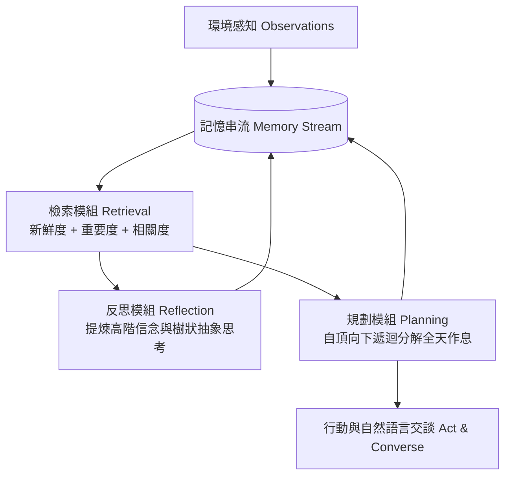

# Generative Agents: Interactive Simulacra of Human Behavior

> [!ABSTRACT] 核心摘要
> 本篇開創性論文提出了「生成式代理人（Generative Agents）」架構，成功將大型語言模型（LLM）擴展為能在開放環境中進行長時程行為模擬的計算個體。作者設計了由「[[Memory-Stream|記憶串流]]」、「[[Reflection-Mechanism|反思機制]]」與「規劃（Planning）」組成的認知架構，並在仿《模擬市民》的 Smallville 虛擬小鎮中部署了 25 位虛擬居民。實驗證明，單憑一個種子想法（舉辦情人節派對），代理人能自發湧現出資訊傳播、關係建立與跨個體群體協調等複雜社會行為。

---

## 1. 研究背景與欲解決之核心問題 (Problem Statement)
- **傳統 ABM 與遊戲 AI 的限制**：
  - 過去數十年，代理人基模型（[[Social-Simulation-ABM|ABM]]）與非玩家角色（NPC）高度仰賴有限狀態機（FSM）或行為樹（Behavior Trees）。這些基於規則的手寫系統成本極高，且無法應對開放世界未預先編程的情境。
  - 強化學習（RL）雖能自主學習策略，但在缺乏明確數值獎勵函數（Reward Function）的開放社交環境中難以定義人類日常行為。
- **純 LLM 直接提示（First-order Prompting）的短板**：
  - 若僅給予單一 Prompt，LLM 只能做出瞬間合理的反應，但**缺乏長期的行為一致性（Long-term Coherence）**。
  - 受限於上下文視窗長度（Context Window），無法將幾天以來的日常觀察與對話全數放入提示詞，導致角色遺忘先前承諾，甚至在一小時內吃三次午餐。

---

## 2. 核心架構與三大支柱 (Core Architecture)

作者將 LLM 作為核心推理引擎，並為其外掛了一套完整的認知記憶與行為生成管線：

### 2.1 記憶串流 (Memory Stream)
- 記錄代理人的一切經歷，以自然語言描述為主體（例如：「Isabella 正在烘烤鬆餅」、「瓦斯爐起火了」），包含建立時間戳與最後訪問時間戳。
- **三維動態檢索分數**：
  $$ \text{Score} = \alpha_{\text{recency}} \cdot \text{Recency} + \alpha_{\text{importance}} \cdot \text{Importance} + \alpha_{\text{relevance}} \cdot \text{Relevance} $$
  1. **新鮮度 (Recency)**：採用指數衰減函數 $0.995^{\Delta t}$，讓剛發生的事件維持在注意力範圍。
  2. **重要度 (Importance)**：在記憶產生時由 LLM 評定 1~10 分（例如「刷牙」為 2 分，「告白/求婚」為 8 分）。
  3. **相關度 (Relevance)**：以文字嵌入向量（Embedding）與當前情境 Query 進行餘弦相似度（Cosine Similarity）比對。

### 2.2 反思機制 (Reflection)
- **問題意識**：若僅有原始觀察記憶，代理人難以歸納通則或高階推論（例如知道 Klaus 常在圖書館看書，但無法抽象出「Klaus 熱愛學術」的信念）。
- **觸發條件**：當累積的新記憶重要性總和超過門檻值（實測約累積 150 分，每天約觸發 2~3 次）。
- **流程**：LLM 檢視最近 100 筆記憶，提出 3 個最顯著的高階問題 $\to$ 檢索關聯證據 $\to$ 提煉出洞察並以指針標記引用的原始記憶，生成**反思樹（Reflection Tree）**回存至記憶串流。

### 2.3 遞迴式規劃與動態反應 (Planning & Reacting)
- **自頂向下遞迴分解**：先生成全日粗略作息（8:00 晨間例行、10:00 上課...），再分解為 1 小時的時間塊，最後遞迴拆解為 5~15 分鐘的微觀動作。
- **動態反應循環**：每個時間步，代理人感知周圍物體與其他居民，由 LLM 評估是否維持現有規劃或觸發即時反應（如看到朋友主動打招呼、發現瓦斯爐著火關閉爐火並重做早餐）。

---

## 3. 實驗設計與社會湧現現象 (Evaluation & Emergent Behaviors)

### 3.1 Smallville 虛擬小鎮實驗
- 在 Phaser 遊戲引擎中建立仿《模擬市民》的像素小鎮，包含咖啡廳、酒吧、學校、藥局與住宅等。
- 注入 25 位具有不同性格、職業與社交關係的代理人（例如藥局老闆 John Lin、咖啡廳店長 Isabella Rodriguez）。

### 3.2 三大社會湧現現象 (Emergent Social Phenomena)
使用者僅給予單一初始種子指令：「*Isabella 想在 2 月 14 日下午辦情人節派對*」，系統自然湧現：
1. **資訊擴散 (Information Diffusion)**：派對消息經由人際口耳相傳擴散至 52% 居民；市長選舉消息擴散至 32% 居民。
2. **關係建立 (Relationship Formation)**：居民在隨機互動與共同話題中形成新朋友與暗戀關係，社群網絡密度從 0.167 大幅提升至 0.74。
3. **自主協調 (Social Coordination)**：居民約定一同前往、協同裝飾咖啡店，並在派對當天準時赴約。

### 3.3 消融實驗 (Ablation Study)
透過 TrueSkill 排名與人工評估比較不同組件的真實度貢獻：
- **完整架構 (Full)**：表現最佳（$\mu = 29.89$）。
- **無反思 (No Reflection)**：代理人只能根據片段事實做生硬回應，無法理解深層動機（$\mu = 26.88$）。
- **無規劃與無反思 (No Reflection & Plan)**：作息嚴重錯亂（如不斷重複進食）（$\mu = 25.64$）。
- **無記憶、無反思、無規劃 (Baseline)**：表現最差（$\mu = 21.21$），退化為傳統無狀態單輪回答。

---

## 4. 局限性與倫理風險 (Limitations & Ethical Risks)
> [!WARNING] 本文指出的重要瓶頸與風險
> 1. **記憶檢索失效與修飾性幻覺 (Embellishment)**：代理人有時會根據預訓練模型內部常識自行添加記憶（如誤認鄰居 Adam Smith 是《國富論》作者）。
> 2. **極度禮貌與過度迎合**：受 RLHF 指令微調影響，代理人語言風格過度正式客氣，且很少拒絕他人的要求。
> 3. **擬人化與準社交關係風險 (Parasocial Relationships)**：使用者可能對虛擬角色產生過度情感依附，系統必須明確揭露其為計算實體。

---

## 5. 關聯研究與脈絡 (Associated Lineage)
- **衍生概念**：
  - [[Generative-Agents]]（核心本體定義）
  - [[Memory-Stream]]（三維檢索公式）
  - [[Reflection-Mechanism]]（反思樹結構）
  - [[Social-Simulation-ABM]]（社會模擬典範移轉）
- **後續綜述與演進**：
  - [[2023_Gao_LLM-Empowered-Agents-for-Simulation-Survey]]
  - [[LLM-Agent-Based-Modeling]]
