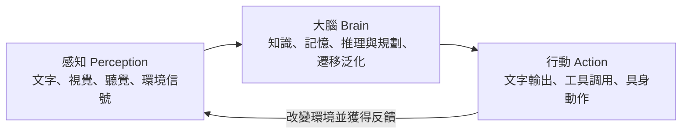

# The Rise and Potential of Large Language Model Based Agents: A Survey

> [!ABSTRACT] 核心摘要
> 本篇 86 頁的全景綜述由復旦大學 NLP 團隊撰寫，系統化梳理了 LLM-based Agents 從哲學起源（亞里斯多德、休謨關於 Agency 的定義）到符號 AI、反應型 AI、強化學習乃至生成式大模型時代的演進全貌。論文確立了單體代理人的「[[Agent-Architecture-Tripartite|大腦-感知-行動 (Brain-Perception-Action)]]」經典三元架構，並在第 5 章深入剖析了由個體邁向群體智慧的「[[Agent-Society-Properties|代理人社會 (Agent Society)]]」四大核心特徵與多代理人協同機制（[[Multi-Agent-Coordination]]），為整個代理人基模擬（ABM）提供了最堅實的分類學基礎。

---

## 1. 核心研究問題與歷史脈絡 (Historical Lineage & Philosophy)
- **哲學起源**：Agency 是指個體擁有信念（Beliefs）、渴望（Desires）、意圖（Intentions）並主動施展意志採取行動的能力，而非被動接受外界刺激。
- **技術演進四部曲**：
  1. **符號代理人 (Symbolic Agents)**：基於邏輯規則與知識專家系統，具備高解釋性，但無法處理真實世界的不確定性。
  2. **反應型代理人 (Reactive Agents)**：捨棄複雜推理，以 Sense-Act 快速映射反應（如簡單避障機器人），但缺乏長期規劃。
  3. **強化學習代理人 (RL-based Agents)**：透過試錯（Trial-and-Error）在環境中學習最大化累積獎勵（如 AlphaGo），但在開放社交無數值獎勵的環境難以泛化。
  4. **大語言模型代理人 (LLM-based Agents)**：以預訓練語言模型為大腦，具備先驗常識、通用推理（CoT）與自然語言溝通能力，跨越了傳統代理人的泛化鴻溝。

---

## 2. 代理人經典三元架構 (Brain - Perception - Action)

1. **大腦模組 (Brain)**：
   - **記憶能力**：解決 Transformer 上下文視窗限制。包含記憶摘要（Summarizing Memory）、向量壓縮檢索（[[Memory-Stream]]）與結構化記憶庫（ChatDB）。
   - **推理與規劃**：思維鏈（CoT）、自頂向下任務分解（Least-to-Most）、反思機制（[[Reflection-Mechanism]]、Self-Refine）。
2. **感知模組 (Perception)**：
   - 突破純文字限制，整合多模態感知：視覺（ViT / Q-Former 投影對齊）、聽覺（AudioGPT 串聯）、環境空間拓撲（3D 地圖、位置座標）。
3. **行動模組 (Action)**：
   - 文字輸出（對話、播報）。
   - 工具使用（Tool Using，如 WebGPT 搜尋、Python 直譯器執行）。
   - 具身動作（Embodied Action，如在虛擬空間導航、機械手臂抓取）。

---

## 3. 代理人社會與模擬 (Agent Society & Social Simulation)

在第 5 章中，論文從「個體性（Individuality）」推展至「社會性（Sociality）」，總結出代理人社會的**四大必備特徵**：
1. **開放性 (Open)**：個體可動態進出系統，外部人類可扮演觀察者或內心聲音直接介入。
2. **持久性 (Persistent)**：社會結構與關係隨時間推移持續累積，不因短期對話結束而消滅。
3. **情境具身性 (Situated)**：個體處於具體環境座標中，感知周遭物體狀態與空間約束。
4. **組織秩序性 (Organized)**：具備物理邊界、社會階層或分工規範。

### 多代理人群體協同的三大模式 (Multi-Agent Dynamics)
- **有序協同 (Ordered Cooperation)**：如 MetaGPT 借鑑瀑布流模型，下游代理人接收上游產出的規格文件，大幅降低混亂度。
- **無序討論 (Disordered Cooperation)**：多個代理人自由發表意見、腦力激盪，或透過多數決投票（Majority Voting）。
- **對抗辯論 (Adversarial Interaction)**：多代理人相互針鋒相對（Tit-for-Tat Debate），透過外部反思修正彼此的偏誤與幻覺。

---

## 4. 關鍵挑戰與出錯反思 (Critical Vulnerabilities)
> [!WARNING] 多代理人互動的重要隱患
> 1. **幻覺無限放大 (Amplification of Hallucination)**：在多代理人連續對話中，若缺乏嚴格的規則驗證或第三方審查（Gatekeeper/Critic），單一代理人的微小幻覺會迅速被其他代理人視為既定事實並繼續推演，最終產生嚴重的群體群盲（Groupthink）。
> 2. **上下文長度耗盡與通訊開銷**：代理人數量增加時，相互通訊訊息呈幾何級數爆炸，極易撐爆 LLM 的上下文視窗。
> 3. **偏見與刻板印象**：代理人容易繼承訓練資料中的偏見，在社會科學模擬中產生偏頗結論。

---

## 5. 關聯研究脈絡 (Associated Lineage)
- **微觀個體原型**：[[2023_Park_Generative-Agents]]（提供具體的記憶串流與反思實作）
- **核心架構衍生**：
  - [[Agent-Architecture-Tripartite]]（大腦-感知-行動架構）
  - [[Agent-Society-Properties]]（社會四大特徵）
  - [[Multi-Agent-Coordination]]（協同機制）
- **總體技術綜述**：[[LLM-Agent-Based-Modeling]]
