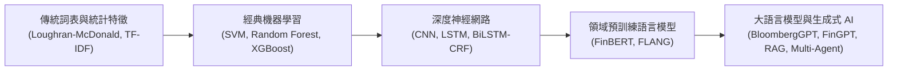

# Natural language processing in finance: A survey

> [!ABSTRACT] 核心摘要
> 本綜述論文對自然語言處理（NLP）在金融領域的應用進行了全面且深入的盤點。作者團隊整合學術研究與業界落地視角，建立了「金融文本資料 $\times$ NLP 技術 $\times$ 核心參與者 $\times$ 金融應用場景」的系統化架構，將金融 NLP 劃分為十大核心應用領域，並依據技術成熟度將其劃分為初探、營運整合與策略最佳化三個階段，指出了結合數值推理、跨文本表格理解、神經符號 AI 與大語言模型（LLMs）的未來演進路徑。

---

## 1. 研究背景與欲解決之核心問題 (Problem Statement)
- **痛點與背景**：
  - 傳統金融分析高度依賴數值與時間序列資料，然而金融市場中超過 80% 的關鍵資訊實質上隱藏在**非結構化文字資料**中（企業財報、法說會電話會議逐字稿 Earnings Calls、新聞、社群媒體論壇等）。
  - 過往的文獻回顧往往偏向單一視角（純 NLP 演算法視角或純金融商管視角），缺乏能貫穿「非結構化文字資料流」、「最新深度學習 / LLM 技術」與「真實金融機構業務」的全景圖譜。
- **核心研究問題 (Research Questions)**：
  1. 金融領域加速導入 NLP 的核心驅動力為何？如何應對金融文字的專業歧義與雜訊？
  2. 新興應用場景（如 ESG 永續金融、可解釋性 AI、數位資產）帶來哪些新機會？
  3. 從傳統詞表（Lexicon）、深度學習（LSTM/CNN）、領域預訓練模型（[[FinBERT]]）到大型語言模型（[[Financial-LLM]]），技術遷移的趨勢與限制為何？

---

## 2. 核心架構與分類體系 (Review Framework & Applications)

作者依據國際貨幣基金組織（IMF）的研究框架並遵循 PRISMA 指引，梳理出**三大資料源**與**十大金融應用領域**：

### 2.1 三大非結構化金融資料來源
1. **企業內部與揭露資料 (Corporate Data)**：財報年報（10-K）、法說會電話會議錄音與逐字稿（Earnings Calls）、新聞稿、監管申報文件、顧客回饋。
2. **公開新聞與總體公告 (Public News & Announcements)**：財經新聞（Bloomberg / Reuters）、總體經濟數據、各國央行政策聲明、分析師研究報告。
3. **社群媒體資料 (Social Media Data)**：X (Twitter)、StockTwits、Reddit、論壇投資人討論。

### 2.2 十大金融 NLP 應用場景
1. **金融情緒分析 ([[Financial-Sentiment-Analysis]])**：從句子級、段落級到層面級（Aspect-level），評估市場情緒與投資人心理。
2. **金融敘事處理 ([[Financial-Narrative-Processing]])**：針對長篇財報的自動摘要（Summarization）與資訊擷取（Information Extraction, 事件/因果關係抽取）。
3. **金融預測 (Financial Forecasting)**：結合文字訊號預測股市（Stock）、外匯（FOREX）、加密貨幣走向與波動率。
4. **投資組合管理 (Portfolio Management)**：利用情緒訊號、主題模型與強化學習（RL）最佳化資產配置與風險調整後報酬（Sharpe / Sortino Ratio）。
5. **問答系統、虛擬助理與聊天機器人 ([[Financial-QA-Benchmarks]])**：融合表格與文字的數值推理（如 [[Financial-QA-Benchmarks|FinQA, TAT-QA]]）以及金融客服。
6. **風險管理 (Risk Management)**：利用 10-K 揭露預測財務風險與市場波動、財報造假與交易舞弊偵測（Fraud Detection）、非傳統文字特徵信用評分（Credit Scoring）。
7. **法規遵循監控 (Regulatory Compliance Monitoring)**：內部通訊監控（預防內線交易與不當操縱）、即時監管條例變更追蹤。
8. **ESG 與永續金融 (ESG and Sustainable Finance)**：ESG 揭露自動辨識、企業綠洗（Greenwashing）防範、永續評級量化。
9. **金融可解釋性人工智慧 (Explainable AI, XAI in Finance)**：特徵重要度（Feature Relevance）、LIME / SHAP、視覺化注意力熱圖（CLEAR）、反事實生成。
10. **數位資產 NLP (NLP for Digital Assets)**：加密貨幣（Bitcoin / Ethereum）社群情緒預測、NFT 數位資產定價動態與社群關注度分析。

---

## 3. 金融 NLP 的技術演進歷程 (Technological Evolution)

1. **詞表到語境感知**：早期的單詞情感詞表（如 Loughran & McDonald 字典）無法處理上下文轉折；後續演進為結合數值與關鍵詞的複合特徵工程，進而轉向密集向量表示（Word Embeddings）。
2. **預訓練模型（Pre-trained Language Models）**：以 [[FinBERT]] 為代表，利用路透社新聞、Yahoo Finance 與財報進行領域預訓練，大幅超越通用 BERT 在金融情緒分析任務上的表現。
3. **大語言模型與 RAG（LLMs & RAG）**：
   - 商業金融 LLM 如 BloombergGPT 證明了領域專用巨量文字訓練的效益；
   - 開源方向則走向以指令微調（Instruction Tuning）為主的 Instruct-FinGPT，以及搭配檢索增強生成（RAG）以降低金融幻覺（Hallucination）。

---

## 4. 三大成熟度階段劃分 (Stages of Maturity and Adoption)

作者在文中提出具指標性的成熟度劃分（圖 3）：
- **初探認知階段 (Initial Awareness)**：
  - 代表領域：XAI、投資組合管理、ESG 永續金融、總體金融預測、數位資產。
  - 特徵：學術熱度高、潛在突破價值大，但業界落地仍面臨資料標準化與黑盒子信任門檻。
- **營運整合階段 (Operational Integration)**：
  - 代表領域：財務風險預測、法規遵循監控、信用評分、詐欺偵測。
  - 特徵：已有 PoC（概念驗證）與初步商業系統，正在經歷對準確度、延遲性與容錯率的嚴格考驗。
- **策略最佳化階段 (Strategic Optimization)**：
  - 代表領域：金融情緒分析（FSA）、資訊擷取（IE）、金融文本摘要、智慧客服與 QA。
  - 特徵：技術相對成熟，已廣泛整合至券商、高頻量化交易、智慧終端（如 Bloomberg / FactSet）的核心策略流程中。

---

## 5. 未來八大關鍵研究方向 (Future Directions)

1. **時間序列 Transformer (Time Series Transformers, TST)**：將長文脈文字資訊與高頻波動時間序列進行跨模態聯合建模。
2. **強化學習與投資組合管理**：結合高斯反向強化學習（Gaussian Inverse RL）過濾市場噪訊，動態微調持倉策略。
3. **神經符號 AI (Neuro-Symbolic AI)**：結合符號邏輯（規則系統、知識圖譜）與神經網路的表徵能力，徹底解決高風險金融決策的可解釋性要求。
4. **混合型數值與表格推理 (Hybrid Tabular & Textual Reasoning)**：跨越財報文字與財務結構化表格（如 TAT-QA、FinQA），克服純語言模型在算術邏輯與多步計算上的短板。
5. **知識圖譜增強的金融敘事處理**：構建企業關聯圖（供應鏈、股權結構、競爭關係），進行深層次因果鏈搜尋（Causal-chain Extraction）。
6. **細粒度層面級情緒分析 (Fine-grained Aspect-based FSA)**：不再只給予整體標籤，而是拆解對「毛利率」、「研發費用」、「市場份額」的細部情緒極性。
7. **法規遵循與模型信任度 (Trustworthiness & Bias Mitigation)**：防止信用評等中的演算法偏見（Algorithmic Bias），確保在嚴格隱私（GDPR、金融資料保護法規）下的安全部署。
8. **跨模態多代理人金融系統 (Multi-Agent Financial Systems)**：多個特定功能的 LLM Agent 協同進行盡職調查、代碼檢驗與投資備忘錄撰寫。

---

## 6. 局限性與批判性思考 (Limitations & Critique)
> [!WARNING] 本文之邊界與局限
> - **廣度勝於深度**：作為全景式 Survey，本文未對各論文的超參數設定、具體訓練算力開銷與資料外洩（Data Contamination）進行逐一評估。
> - **量化實測回測缺失**：許多文獻宣稱在情緒分析或預測上大幅超越 Baseline，但缺少在真實滑價（Slippage）、交易手續費與市場衝擊成本下的即時盤實測驗證。

---

## 7. 關聯研究脈絡 (Associated Lineage)
- **核心相關概念**：
  - [[Financial-Sentiment-Analysis]]
  - [[Financial-Narrative-Processing]]
  - [[FinBERT]]
  - [[Financial-LLM]]
- **核心相關基準測試**：
  - [[Financial-Sentiment-Benchmarks]]（PhraseBank, FiQA Task 1, SemEval 2017 Task 5）
  - [[Financial-QA-Benchmarks]]（FinQA, TAT-QA, ConvFinQA）
- **總體技術演進綜述**：
  - [[Financial-NLP-Landscape]]
