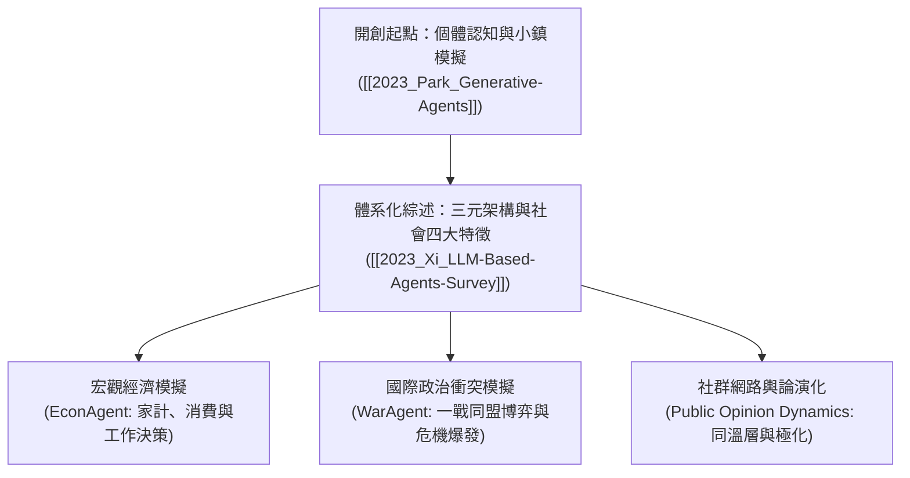

# 大語言模型賦能之代理人基模擬綜述 (LLM-based ABM Synthesis)

> [!ABSTRACT] 綜述視角
> 本綜述追蹤「大型語言模型（LLM）」與「代理人基模型（ABM）」結合的技術演進歷程。從 [[2023_Park_Generative-Agents|Stanford 虛擬小鎮]] 所奠定的微觀個體認知（記憶、反思、規劃），到 [[2023_Xi_LLM-Based-Agents-Survey|復旦大學全景綜述]] 提出的三元架構（Brain-Perception-Action）與社會四大特徵，逐步建構起現代計算社會科學的理論與工程大廈。

---

## 1. 代理人模擬系統演進脈絡 (Evolutionary Trajectory)

---

## 2. 核心技術組件成熟度矩陣 (Component Maturity Matrix)

| 組件名稱 | 核心功能 | 代表技術 / 論文 | 目前瓶頸與挑戰 |
| :--- | :--- | :--- | :--- |
| **三元架構** | 統整大腦、感知與行動 | [[Agent-Architecture-Tripartite]] | 多模態感知整合成本高、肢體動作落地難 |
| **記憶架構** | 儲存長期經歷並適時喚醒 | [[Memory-Stream]] 三維檢索公式 | 歷史記憶爆炸時檢索精確度衰減、Token 成本昂貴 |
| **高階認知** | 從事實經驗抽象出價值觀與信念 | [[Reflection-Mechanism]] 樹狀反思 | 容易繼承預訓練模型的刻板印象與修飾性幻覺 |
| **社會特徵** | 定義虛擬社會運作基本屬性 | [[Agent-Society-Properties]] (開放/持久/具身/組織) | 難以長期維持系統自組織平衡 |
| **群體協同** | 多個體分工、博弈與辯論 | [[Multi-Agent-Coordination]] (有序/無序/對抗) | 幻覺無限放大 (Amplification of Hallucination) |

---

## 3. 已收錄文獻演進索引 (Lineage of Ingested Papers)
1. **[[2023_Park_Generative-Agents]]**：確立微觀認知三元組（記憶串流、反思樹、遞迴規劃）與 Smallville 25 人小鎮社會湧現。
2. **[[2023_Xi_LLM-Based-Agents-Survey]]**：確立 Brain-Perception-Action 巨集觀架構、代理人社會四大特徵與多代理人協同博弈機制。
