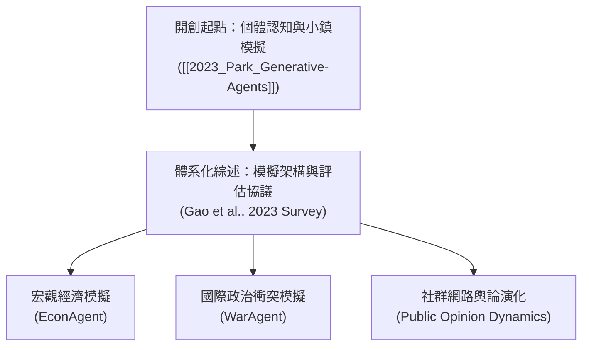

# 大語言模型賦能之代理人基模擬綜述 (LLM-based ABM Synthesis)

> [!ABSTRACT] 綜述視角
> 本綜述追蹤「大型語言模型（LLM）」與「代理人基模型（ABM）」結合的技術演進歷程。從 [[2023_Park_Generative-Agents|Stanford 虛擬小鎮]] 所奠定的微觀認知架構（記憶、反思、規劃），逐步擴展至社會、經濟、政治與輿論動態的宏觀模擬。

---

## 1. LLM 代理人模擬系統演進脈絡

---

## 2. 核心技術組件成熟度矩陣

| 組件名稱 | 核心功能 | 代表技術 / 論文 | 目前瓶頸與挑戰 |
| :--- | :--- | :--- | :--- |
| **記憶架構** | 儲存長期經歷並適時喚醒 | [[Memory-Stream]] 三維檢索公式 | 記憶過長時檢索精確度衰減、檢索延遲與 Token 成本 |
| **高階認知** | 從事實經驗抽象出價值觀與信念 | [[Reflection-Mechanism]] 樹狀反思 | 容易繼承預訓練模型的刻板印象與幻覺修飾 |
| **行為規劃** | 自頂向下分解全天作息與即時應變 | Recursive Decomposition | 容易表現過於禮貌迎合、極少拒絕他人 |
| **社會環境** | 承載代理人活動的空間與物理邊界 | Smallville 空間樹狀圖 (Phaser) | 物理常識與空間語義落差（如誤入已打烊商店） |

---

## 3. 已收錄文獻演進索引 (Lineage of Ingested Papers)
1. **[[2023_Park_Generative-Agents]]**：確立微觀認知三元組（記憶串流、反思樹、遞迴規劃）與 Smallville 25 人小鎮社會湧現。
